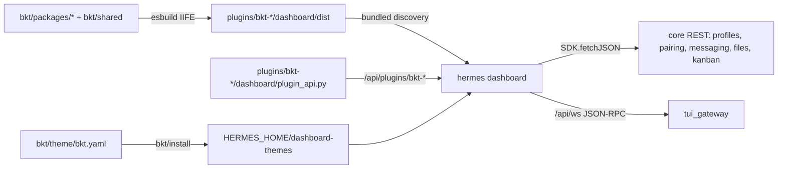

# BKT dashboard plugins, theme and branding

## Overview

This plan adds nine `bkt-*` dashboard extensions to the Hermes fork as purely additive files. It
does not edit any existing tracked file, so merging upstream `main` stays conflict-free. Every
contract field and decision comes from the accepted brainstorm:
[brainstorm-261023-1038-bkt-dashboard-plugins.md](../reports/brainstorm-261023-1038-bkt-dashboard-plugins.md).

Architecture:
- The TypeScript source lives in `bkt/`, an npm workspace that builds with esbuild.
- Each plugin is built into a single IIFE at `plugins/bkt-<name>/dashboard/dist/index.js`, and
  the dashboard discovers those files as bundled plugins.
- React and the UI primitives come from `window.__HERMES_PLUGIN_SDK__`. Shared helpers are
  bundled into each plugin from `bkt/shared/`.
- Backend routes are `plugins/bkt-<name>/dashboard/plugin_api.py`, mounted at
  `/api/plugins/bkt-<name>/`.
- The theme YAML ships in `bkt/theme/` and `bkt/install` copies it into
  `<HERMES_HOME>/dashboard-themes/`.

## Constraints

- Only add new paths. The allowed new roots are `bkt/`, `plugins/bkt-*/`, `tests/plugins/bkt_*/`
  and `docs/bkt/`. No existing tracked file is modified.
- Plugins use only the public plugin SDK and core REST endpoints. Python imports of Hermes
  internals are limited to the helpers named in each phase file. Each such import is listed in
  `bkt/UPSTREAM-SEAMS.md` so a sync can recheck it.
- New file operations reuse the core managed-files policy (`hermes_cli/web_server_files.py`:
  `_managed_files_policy`, `_resolve_managed_path`), so `locked_root` and the blocked trees
  still apply.
- Every route that works on a profile resolves that profile explicitly. Secrets are masked in
  responses unless the user explicitly asks to reveal them.
- Everything works on native Windows and on WSL or Linux.
- The colours are BKT primary `#00ADEF`, secondary `#3F51B5`, tertiary `#A2D149` (success
  only), surfaces `#0E1012`, `#1A1C1E`, `#212428` and `#282B30`, and text `#F0F4F8` and
  `#94A3B8`.

## Non-goals

- No desktop app plugins.
- No upstream PRs.
- No `tab.override` of the core pages. Profiles and Files get new tabs next to the core pages.
- bkt-usage and bkt-sessions-export are deferred.

## Phases

| # | Phase | Effort | Depends on | Status |
|---|-------|--------|------------|--------|
| 1 | [Workspace foundation and merge guard](./phase-01-workspace-foundation.md) | 1d | none | Pending |
| 2 | [Theme, brand logo and author](./phase-02-theme-brand-author.md) | 0.5d | 1 | Pending |
| 3 | [bkt-profiles](./phase-03-bkt-profiles.md) | 1.5d | 1 | Pending |
| 4 | [bkt-files](./phase-04-bkt-files.md) | 2d | 1 | Pending |
| 5 | [bkt-chat](./phase-05-bkt-chat.md) | 2d | 1 | Pending |
| 6 | [bkt-kanban-workflow](./phase-06-bkt-kanban-workflow.md) | 0.75d | 1 | Pending |
| 7 | [bkt-health and bkt-prompts](./phase-07-bkt-health-prompts.md) | 1d | 1, 3 | Pending |
| 8 | [Verification, docs and sync rehearsal](./phase-08-verification-docs.md) | 0.5d | 2-7 | Pending |

Phases 2 to 6 only depend on phase 1, so they can run in parallel. Each phase owns a separate
plugin directory. `bkt/shared/` belongs to phase 1, and later phases add new files to it but
never edit an existing one. Any change to an existing shared file goes back through the owner of
phase 1.

## Acceptance criteria

- [ ] `bkt/scripts/check-additive.mjs` passes. It requires `git diff --diff-filter=MDR main...HEAD`
      to be empty outside `plans/`.
- [ ] A trial merge of upstream `main` into a scratch branch finishes with no conflicts.
- [ ] `/api/dashboard/plugins` lists all nine `bkt-*` plugins. Each tab or slot renders, and
      the browser console shows no errors.
- [ ] The BKT theme can be chosen in the theme picker, and the logo shows in the header.
- [ ] The backend routes pass `scripts/run_tests.sh tests/plugins/bkt_*`, and the shared
      helpers pass the `bkt/` vitest suite.
- [ ] Manual end-to-end checks pass on native Windows and on WSL or Linux, using a temporary
      `HERMES_HOME`.

## Upstream-sync risks

- The `/api/ws` JSON-RPC contract may drift. The bkt-chat contract smoke test in phase 5 detects
  this.
- The internals imported by the Python routes may move. `bkt/UPSTREAM-SEAMS.md` lists them and
  the phase 8 import test checks them.
- The bundled-plugin discovery path or the SDK surface may change. The phase 8 discovery test
  detects this.
