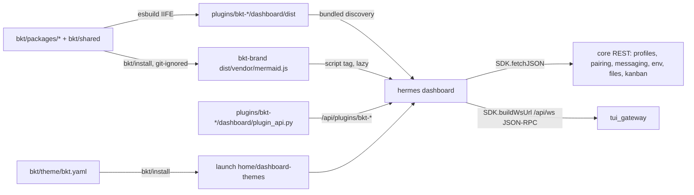

# BKT dashboard plugins, theme and branding

## Overview

This plan adds eight `bkt-*` dashboard plugins and one dashboard theme to the Hermes fork as
purely additive files. BKT work does not edit any tracked file that already exists on
`main-bktech`, so it adds no new conflicts when upstream `main` is merged. The fork already
modifies about 588 tracked files compared with `main` (the CNCNS rebrand, Vietnamese i18n and
logo commits). Those are an existing baseline and are out of scope here. Every contract field and
decision comes from the accepted brainstorm:
[brainstorm-261023-1038-bkt-dashboard-plugins.md](../reports/brainstorm-261023-1038-bkt-dashboard-plugins.md).
<!-- Red Team: additive baseline is main-bktech, not main; eight plugins plus one theme -->

The eight plugins are `bkt-brand`, `bkt-author`, `bkt-profiles`, `bkt-files`, `bkt-chat`,
`bkt-kanban-workflow`, `bkt-health` and `bkt-prompts`. The theme is `bkt/theme/bkt.yaml`, because
a plugin cannot ship a theme (`hermes_cli/web_server_dashboard.py:431-437`).

Architecture:
- The TypeScript source lives in `bkt/`, a standalone npm package that is not a member of the
  root workspace. It builds with esbuild and has its own committed `bkt/package-lock.json`.
- Each plugin is built into a single IIFE at `plugins/bkt-<name>/dashboard/dist/index.js`, and
  the dashboard discovers those files as bundled plugins. Bundled plugins load without
  `plugins.enabled`; only an explicit `plugins.disabled` entry stops them
  (`hermes_cli/web_server_dashboard.py:807-811`).
- React, the UI primitives, `fetchJSON`, `authedFetch` and `buildWsUrl` come from
  `window.__HERMES_PLUGIN_SDK__`. Shared helpers are bundled into each plugin from `bkt/shared/`.
- Every committed `dist/` file stays under the 500 KiB blob-size gate
  (`scripts/ci/check_blob_size.py:40`). Mermaid is never committed: `bkt/install` builds it into
  a git-ignored vendor file (see phase 1).
- Backend routes are `plugins/bkt-<name>/dashboard/plugin_api.py`. Each one is declared with
  `"api": "plugin_api.py"` in the manifest and mounted at `/api/plugins/bkt-<name>/`. Each
  request already runs inside `_plugin_route_secret_scope`, which binds `?profile=`
  (`hermes_cli/web_server_dashboard.py:934-957`).
- The theme YAML ships in `bkt/theme/`, and `bkt/install` copies it into
  `<launch home>/dashboard-themes/`, the directory the dashboard process reads.

## Constraints

- Only add new paths. The allowed new roots are `bkt/`, `plugins/bkt-*/`, `tests/plugins/bkt_*/`
  and `docs/bkt/`. No tracked file that exists on `main-bktech` is modified, deleted or renamed.
- Plugins use only the public plugin SDK and core REST endpoints. Python imports of Hermes
  internals are limited to the helpers named in each phase file. Each such import is listed in
  `bkt/UPSTREAM-SEAMS.md` so a sync can recheck it.
- New file operations apply every core file guard, not only the managed policy:
  - `_resolve_managed_path` (`hermes_cli/web_server_files.py:302`) enforces `locked_root`.
  - `_is_sensitive_path` (`hermes_cli/web_routers/files.py:97`) blocks credential files and
    trees.
  - `_refuse_live_database` (`files.py:201`) blocks open SQLite files.
  - On a local install `locked_root` is `None` (`web_server_files.py:298-299`), so the
    sensitive-path and HERMES_HOME guards are the real protection there.
- Every route and client call that works on a profile resolves that profile explicitly, using
  the transport each core endpoint actually reads (query or JSON body). Secrets are masked in
  responses unless the user explicitly asks to reveal them.
- Agent and file content is untrusted. Markdown renders without raw HTML, and mermaid runs with
  `securityLevel: 'strict'`.
- Everything works on native Windows and on WSL or Linux.
- The colours are BKT primary `#00ADEF`, secondary `#3F51B5`, tertiary `#A2D149` (success
  only), surfaces `#0E1012`, `#1A1C1E`, `#212428` and `#282B30`, and text `#F0F4F8` and
  `#94A3B8`.

## Non-goals

- No desktop app plugins.
- No upstream PRs.
- No `tab.override` of the core pages. Profiles and Files get new tabs in the plugin section of
  the sidebar. The shell groups plugin tabs separately from core tabs
  (`web/src/App.tsx:292-305`), so they cannot sit directly next to the core pages.
- bkt-usage and bkt-sessions-export are deferred.
- Reconciling the existing CNCNS rebrand changes with upstream.

## Phases

| # | Phase | Effort | Depends on | Status |
|---|-------|--------|------------|--------|
| 1 | [Workspace foundation and merge guard](./phase-01-workspace-foundation.md) | 1.5d | none | Done |
| 2 | [Theme, brand logo and author](./phase-02-theme-brand-author.md) | 0.5d | 1 | Done |
| 3 | [bkt-profiles](./phase-03-bkt-profiles.md) | 1.75d | 1 | Done |
| 4 | [bkt-files](./phase-04-bkt-files.md) | 2.5d | 1 | Done |
| 5 | [bkt-chat](./phase-05-bkt-chat.md) | 2d | 1 | Done |
| 6 | [bkt-kanban-workflow](./phase-06-bkt-kanban-workflow.md) | 1d | 1 | Done |
| 7 | [bkt-health and bkt-prompts](./phase-07-bkt-health-prompts.md) | 1d | 1, 5 | Done |
| 8 | [Verification, docs and sync rehearsal](./phase-08-verification-docs.md) | 0.5d | 2-7 | In progress (native Windows and WSL runs pending) |

Phases 2 to 6 only depend on phase 1, so they can run in parallel. Phase 7 waits for phase 5,
because bkt-chat owns the prompt prefill reader. Each phase owns a separate plugin directory and
a separate `bkt/packages/<name>/` directory.

Phase 1 owns every shared file: `bkt/shared/`, `bkt/package.json`, `bkt/package-lock.json`,
`bkt/scripts/build.mjs` and `bkt/UPSTREAM-SEAMS.md`. It declares every package entry and every
dependency up front, so later phases never edit those files. A later phase may add a new file
under `bkt/shared/` and may append its own section to `bkt/UPSTREAM-SEAMS.md`. Any change to an
existing shared file goes back through the owner of phase 1.
<!-- Red Team: Phase 7 depends on 5; phase 1 owns package.json and build list -->

## Acceptance criteria

- [x] `node bkt/scripts/check-additive.mjs` passes. With the default base `main-bktech`, it
      requires `git diff --name-status <merge-base>...HEAD` to show no `M`, `D` or `R` entry
      outside `plans/`, and no `A` entry outside `plans/` and the allowed new roots.
- [ ] `node bkt/scripts/check-dist-fresh.mjs` passes, meaning a clean rebuild leaves
      `plugins/bkt-*/dashboard/dist` unchanged in git. Pending the first commit of the BKT files;
      a clean rebuild already reproduces all 16 bundle files byte for byte, and the script passed
      on the committed sync-rehearsal tree.
- [x] A trial merge of upstream `main` into a scratch branch adds no conflict in any BKT-owned
      path. Conflicts in files from the existing rebrand baseline are recorded but not counted.
- [x] `/api/dashboard/plugins` lists exactly the eight `bkt-*` plugins named above. Each tab or
      slot renders, and the browser console shows no errors.
- [x] The BKT theme can be chosen in the theme picker, and the logo shows in the sidebar header.
- [x] The backend routes pass `scripts/run_tests.sh tests/plugins/bkt_*`, and the shared
      helpers pass the `bkt/` vitest suite.
- [x] `python scripts/check` adds no findings on BKT files, including the blob-size guard.
- [ ] Manual end-to-end checks pass on native Windows and on WSL or Linux, using a temporary
      `HERMES_HOME` and at least two profiles. Done on macOS only (every tab, both themes, two
      profiles, no page errors); native Windows and WSL runs are still to do.

## Upstream-sync risks

- The `/api/ws` JSON-RPC contract may drift. The bkt-chat contract test in phase 5 detects name
  drift. `check-dist-fresh` and the sync checklist force a rebuild, so the bundled copy of
  `apps/shared` never goes stale.
- The internals imported by the Python routes may move. `bkt/UPSTREAM-SEAMS.md` lists them, and
  the phase 8 import test checks them.
- The bundled-plugin discovery path or the SDK surface may change. The phase 8 discovery test
  detects this.
- The kanban database helpers may change. The bkt-kanban-workflow backend lists them in seams.

## Red Team Review

### Session — 2026-10-23
**Findings:** 15 (15 accepted, 0 rejected). Three suggested fixes were narrowed:
- #6 keeps the user's decision to generate the key on the backend.
- #9 rejects a CDN, because the fork must work offline.
- #12 rejects runtime bundle-hash checks as over-engineering.

**Severity breakdown:** 3 Critical, 9 High, 3 Medium

| # | Finding | Severity | Disposition | Applied To |
|---|---------|----------|-------------|------------|
| 1 | The additive guard compared against `main` (588 baseline paths) and missed `A` entries. There is no `upstream` remote, and `Logo.png` is tracked | Critical | Accept | plan.md, Phase 1, 2, 8 |
| 2 | The `footer-right` slot is declared but never rendered | Critical | Accept | Phase 2 |
| 3 | bkt-files skipped `_is_sensitive_path`, the live-DB guard and HERMES_HOME protection | Critical | Accept | plan.md, Phase 4 |
| 4 | Inline editing through `fs/write-text` bypasses the managed policy and can hit an SSH backend | High | Accept | Phase 4 |
| 5 | Symlinks in source and destination trees, and a gap between checking and using a path | High | Accept | Phase 4 |
| 6 | The API-key backend duplicated core env writes and lacked the token, rate-limit and audit checks. It also missed `config.yaml` precedence and the multiplex endpoint | High | Accept (narrowed) | Phase 3 |
| 7 | Pairing approve and revoke read the profile from the JSON body | High | Accept | Phase 1, 3 |
| 8 | bkt-chat auth, the per-RPC profile, and the approval and clarify contract | High | Accept | Phase 5 |
| 9 | A mermaid chunk is impossible with IIFE output. The plan also missed the blob-size gate, bundled five copies, had no strict mode and listed an unused `fflate` | High | Accept (narrowed) | plan.md, Phase 1 |
| 10 | Kanban `/board` has no link pairs, and `/tasks/{id}/log` is worker output | High | Accept | Phase 6 |
| 11 | "Global" prompts are impossible with per-profile `plugin_db`, and a module-level connection would leak the launch profile | High | Accept | Phase 7 |
| 12 | Committed `dist` bundles go stale with no check | High | Accept (narrowed) | plan.md, Phase 1, 8 |
| 13 | There are eight plugins plus one theme, not nine | Medium | Accept | plan.md, Phase 8 |
| 14 | The `@hermes/shared` alias, the lockfile, the manifest `api` field, installing the theme in the launch home, and the rescan step | Medium | Accept | Phase 1, 5 |
| 15 | Tab placement, kanban sort order, the collapsed header, the Phase 7 dependency, a duplicate upload route, health polling and the dropped WhatsApp onboarding | Medium | Accept | plan.md, Phase 2, 3, 4, 6, 7 |

### Whole-Plan Consistency Sweep
- Files reread: plan.md, phase-01 to phase-08.
- Decision deltas checked: 15. They were the merge-guard base and `A` filter, the author slot,
  file guards, the bkt write route, symlinks, API-key persistence, profile transport, chat
  protocol, mermaid delivery, the kanban backend, prompt scoping, dist freshness, the plugin
  count, build plumbing, and placement and dependencies.
- Stale terms searched: "nine", `footer-right`, `/upload-tree`, `/overview`, `fs/write-text`,
  `approval.pending`, `/tasks/{id}/log`, `after:<core page>`, "untracked", `fflate`,
  "rescan", `main...HEAD`, `withProfile`, "lazily loaded chunk" and "global". Every remaining
  hit is an intentional explanation of why the old approach was dropped.
- Reconciled stale references: 3.
  - Phase 6 named a nonexistent kanban link reader. It now uses `kanban_db_connect` and bounded
    queries.
  - Phase 1 relied on parsing `hermes profile list`. It now derives homes from
    `hermes config path`.
  - The phase 3 manifest position changed from `after:profiles` to `end`.
- Unresolved contradictions: 0. Three choices were made on the reviewers' recommendation and
  were then confirmed in Validation Session 1: the author line moves to `post-main`, mermaid is
  built at install time, and prompts are per profile only.

## Validation Log

### Session 1 — 2026-10-23
**Trigger:** `/ck:plan validate`, run right after the red-team review.
**Questions asked:** 6

### Verification Results
- **Tier:** Full (8 phases).
- **Claims checked:** about 45, across the red-team fact-check, flow-trace, scope and contract
  passes, plus the controller's spot checks.
- **Verified:** about 37 | **Failed:** 8, all corrected in the red-team edits | **Unverified:** 0
  (the one `[UNVERIFIED]` tag, the `hermes profile list` output, was resolved from
  `hermes_cli/subcommands/profile.py:14`).
- **Remaining failures:** 0.
- **Corrected failures:**
  - The `footer-right` slot.
  - The `main` additive baseline.
  - The `upstream` remote.
  - "Untracked" `Logo.png`.
  - The kanban `/board` links and `/log` claims.
  - `approval.pending` as live approvals.
  - Managed policy implying the blocked trees.
  - `fs/write-text` applying the managed policy.

#### Questions & Answers

1. **[Architecture]** The dashboard never renders the footer-right slot, so the author line
   "Son Do · sondn2010@gmail.com" can't sit in the footer without editing core. Where should it
   go?
   - Options: post-main strip | About tab only | header-right
   - **Answer:** post-main strip
   - **Rationale:** Keeps the author visible on every page without a core edit.
2. **[Tradeoffs]** Mermaid is over 2 MB minified, but every committed file must stay under the
   500 KiB blob-size gate, and IIFE bundles can't lazily split. How should mermaid diagrams be
   delivered?
   - Options: Build at install | No mermaid rendering | Commit + allowlist
   - **Answer:** Build at install
   - **Rationale:** Keeps the additive rule and the blob-size gate, and still renders offline.
3. **[Architecture]** Plugin storage is per profile, so the plan's "global" prompts
   (profile = null) cannot work. What scope should bkt-prompts have?
   - Options: Per profile only | Per profile + global
   - **Answer:** Per profile only
   - **Rationale:** Matches `plugin_db` and removes a cross-profile store and its seam.
4. **[Scope]** The plan dropped two brainstorm "suggested extras": a memory viewer in
   bkt-profiles and a recent-folders breadcrumb in bkt-files. Include them?
   - Options: Leave both out | Add both | Recent folders only | Memory viewer only
   - **Answer:** Leave both out
   - **Rationale:** Scope stays as planned.
5. **[Scope]** The plan added extras the brainstorm never accepted: prompt {{variables}} and JSON
   import/export, the kanban time-window filter and node drill-down, and a health status dot in
   the header. Which should stay?
   - Options (multi-select): Prompt variables + JSON I/O | Kanban window + drill-down | Health
     header dot
   - **Answer:** All three stay.
   - **Rationale:** The user has now accepted these as scope. They are no longer drift.
6. **[Assumptions]** The sync rehearsal needs an `upstream` remote, and only `origin`
   (sondn2010/hermes-agent-fork) exists. Which upstream should docs/bkt/README.md and Phase 8
   use?
   - Options: NousResearch/hermes-agent | origin/main only
   - **Answer:** NousResearch/hermes-agent
   - **Rationale:** The rehearsal then tests real upstream drift.

#### Confirmed Decisions
- Author line: `post-main` strip plus `/bkt-about`, because the footer slots are never rendered.
- Mermaid: built at install time into a git-ignored vendor file, because of the blob-size gate
  and the additive rule.
- Prompts: per profile only, shared through JSON export and import.
- Brainstorm extras left out: the memory viewer and recent folders.
- Plan extras kept: prompt variables and JSON I/O, the kanban window and drill-down, and the
  health header dot.
- Upstream remote: `https://github.com/NousResearch/hermes-agent.git`.

#### Action Items
- [x] Mark the confirmations in phases 1, 2, 6 and 7.

#### Impact on Phases
- Phase 1: the mermaid vendor build is confirmed, and so is the upstream URL used by phase 8.
- Phase 2: the `post-main` author line is confirmed.
- Phase 6: the time window filter and drill-down are confirmed in scope.
- Phase 7: per-profile prompts are confirmed, and variables, JSON I/O and the header dot stay.
- Phase 8: already uses the NousResearch upstream URL. No change.

### Whole-Plan Consistency Sweep
- Files reread: plan.md, phase-01 to phase-08.
- Decision deltas checked: 6. Every answer matched the plan text written by the red-team pass,
  so the edits only added confirmation markers.
- Stale terms searched: "confirmed in validation", "global", `footer`, `upstream`,
  "allowlist", "memory viewer" and "recent folders". There were no contradicting hits.
- Reconciled stale references: 1. The red-team sweep's "confirmed in validation" wording now
  points to Session 1.
- Unresolved contradictions: 0.

## Implementation Notes — 2026-10-23

- `Logo.png` was first committed on this branch, not on `main-bktech`, so it shows as an `A`
  entry. The user's decision keeps it at the root, so `check-additive.mjs` exempts that one path.
  The brand plugin ships its own copy in `plugins/bkt-brand/dashboard/assets/logo.png`.
- Phase 3 corrected two premises from source: a usable `.env` key wins over `config.yaml`, and a
  named profile has its own listener only when it is standalone (see the phase 3 file).
- The security review
  ([report](../reports/code-reviewer-261023-1240-bkt-plugins-review.md)) found one Critical, three
  High and three Medium issues in bkt-files. All are fixed, each with a regression test that
  failed on the unfixed code. The Critical finding (Unicode aliases of credential names) also
  affects core `_is_sensitive_filename`. That core issue is left for a private report under
  `SECURITY.md`; no public issue was filed.
- Still open: native Windows and WSL manual runs, including the four Windows-only tests, and
  `check-dist-fresh` after the first commit.
