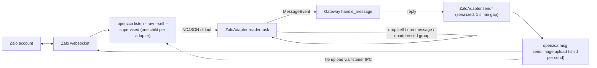

# Zalo channel via openzca and BKT CLI/Desktop skin

## Overview

This plan adds two independent pieces to the fork, both as new files (the `bkt/` and `docs/bkt/`
trees are fork-owned, so editing files there is still additive against upstream):

1. A `zalo` gateway platform at `plugins/platforms/zalo/` that drives a personal Zalo account through
   the `openzca` CLI: one supervised `openzca listen --raw` child for inbound, one short `openzca msg`
   child per outbound send. DMs, groups (mention-gated) and media both ways.
2. A `bkt` skin (`bkt/theme/skins/bkt.yaml`) that repaints the CLI/TUI and, through its `customCSS`,
   the Desktop app; `bkt/install.mjs` learns to copy it into `<home>/skins/`. The dashboard theme
   `bkt/theme/bkt.yaml` already exists and is not touched.

Source contract: [brainstorm report](../reports/brainstorm-261023-2110-zalo-and-bkt-theme.md)
(read "Revision 2026-10-26"). openzca evidence:
[researcher report](../reports/researcher-261026-0210-openzca-cli-contract.md).

## Outcome, constraints, non-goals

- **Outcome:** a Zalo DM or an @mention in a Zalo group reaches the agent and gets a reply in the
  same thread; images and files flow both ways; `/skin bkt` repaints CLI/TUI and Desktop in BKT
  brand colors.
- **Constraints:** additive only against upstream; the adapter uses only the plugin API plus the
  documented `openzca` CLI; credentials stay in openzca's profile store, never in the repo or logs;
  every env read goes through `gateway.platforms._shared.get_scoped_secret`; no `os.environ`
  writes; the listen child is terminated on `disconnect()`.
- **Non-goals:** the official Zalo OA / Bot API; the CNCNS rebrand; redoing the dashboard theme;
  typing indicators and reactions; native outbound voice/video bubbles (openzca's voice and video
  uploads kick the running listener, so those go out as file attachments); upstream contribution.

## Architecture

Chat IDs: a DM is the peer UID (`123`), a group is `group:<groupId>`. The prefix carries the thread
type through restarts and cron delivery, so `send()` always knows whether to pass `--group`.

## Phases

| # | Phase | Effort | Depends on | Owns | Status |
|---|---|---|---|---|---|
| 1 | [openzca process layer, adapter skeleton and DMs](./phase-01-adapter-skeleton-and-dms.md) | 1d | — | `plugins/platforms/zalo/{__init__,adapter,openzca_proc,plugin.yaml}`, `tests/plugins/platforms/zalo/` | Pending |
| 2 | [Group chats and the mention guard](./phase-02-group-chats.md) | 0.5d | 1 | `plugins/platforms/zalo/groups.py`, its tests | Pending |
| 3 | [Media both ways](./phase-03-media.md) | 0.5d | 1 | `plugins/platforms/zalo/media.py`, its tests | Pending |
| 4 | [BKT skin and installer](./phase-04-bkt-skin.md) | 0.5d | — | `bkt/theme/skins/bkt.yaml`, `bkt/install.mjs`, `bkt/scripts/install.test.ts` | Pending |
| 5 | [Docs and live verification](./phase-05-docs-and-verification.md) | 0.5d | 1–4 | `docs/bkt/zalo.md`, `docs/bkt/README.md` | Pending |

Phase 4 shares no files with phases 1–3 and can run in parallel with them. Phases 2 and 3 each add
one sibling module and a small hook in `adapter.py`, so run them sequentially to avoid edits to the
same file colliding.

## Acceptance criteria

- [ ] `git diff origin/main --name-status` for this work lists only `A` entries outside `bkt/` and
      `docs/bkt/` (run `node bkt/scripts/check-additive.mjs`).
- [ ] `scripts/run_tests.sh tests/plugins/platforms/zalo/` passes, including the test that a killed
      or disconnected adapter leaves no live `listen` child.
- [ ] `scripts/run_tests.sh tests/gateway/test_shared_platform_boilerplate.py` still passes with the
      new plugin discovered.
- [ ] Live: a Zalo DM from an allowed user gets an agent reply in that DM.
- [ ] Live: an @mention of the account in a group gets a reply in that group; an unaddressed group
      line gets none.
- [ ] Live: an inbound image and an inbound file reach the agent; the agent sends an image back.
- [ ] Live: `/skin bkt` repaints the CLI; Desktop shows BKT surfaces, cyan primary and focus ring.
- [ ] `cd bkt && npm test` passes (installer copies the skin into `<home>/skins/`).

## Risks

| Risk | Mitigation |
|---|---|
| Zalo bans or logs out the account (reverse-engineered protocol) | Use a dedicated account; serialize sends with a 1 s minimum gap; a login failure is a non-retryable fatal error telling the operator to re-run `openzca auth login` |
| openzca changes its `--raw` field names or send output | Parser ignores unknown fields, skips non-JSON lines, logs and drops lines it cannot route; `msgId` is regex-parsed and optional |
| Orphaned Node `listen` child | `disconnect()` terminates, waits 5 s, then kills; covered by a real-subprocess test |
| Agent answers itself or the account owner's phone | `--self` lines with `senderId == own UID` are dropped before dispatch |
| Per-send Node start-up adds 1–3 s latency | Accepted for personal-agent volume; a long-lived sidecar is the documented upgrade path if needed |
| Windows `openzca.cmd` shim cannot be spawned directly | Resolve the shim's directory and run `node <dir>/node_modules/openzca/dist/cli.js` |

## Unresolved questions

- Which Zalo account is used for live verification, and is it dedicated?
- Is Node 22.13+ present on the deploy hosts?
- Should the BKT skin carry a light-terminal overlay, given that the brand palette is dark-only?
