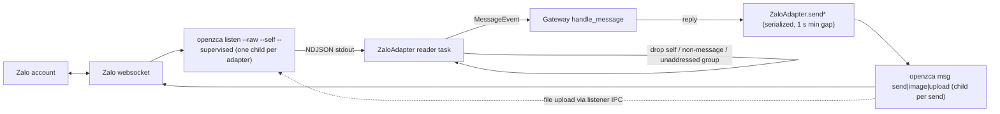

# Zalo channel via openzca and BKT CLI/Desktop skin

## Overview

This plan adds two independent pieces to the fork, both as new files (the `bkt/` and `docs/bkt/`
trees are fork-owned, so editing files there is still additive against upstream):

1. A `zalo` gateway platform at `plugins/platforms/zalo/` that drives a personal Zalo account through
   the `openzca` CLI: one supervised `openzca listen --raw` child for inbound, one short `openzca msg`
   child per outbound send. DMs, groups (mention-gated) and media both ways.
2. A `bkt` skin (`bkt/theme/skins/bkt.yaml`) that repaints the CLI/TUI and, through its `customCSS`,
   the Desktop app; `bkt/install.mjs` learns to copy it into `<home>/skins/`. The dashboard theme
   `bkt/theme/bkt.yaml` already exists and is not touched.

Source contract: [brainstorm report](../reports/brainstorm-261023-2110-zalo-and-bkt-theme.md)
(read "Revision 2026-10-26"). openzca evidence:
[researcher report](../reports/researcher-261026-0210-openzca-cli-contract.md).

## Outcome, constraints, non-goals

- **Outcome:** a Zalo DM or an @mention in a Zalo group reaches the agent and gets a reply in the
  same thread; images and files flow both ways; `/skin bkt` repaints CLI/TUI and Desktop in BKT
  brand colors.
- **Constraints:** additive only against upstream; the adapter uses only the plugin API plus the
  documented `openzca` CLI; credentials stay in openzca's profile store, never in the repo or logs;
  every env read goes through `gateway.platforms._shared.get_scoped_secret`; no `os.environ`
  writes; the listen child is terminated on `disconnect()`; the openzca home directory (`~/.openzca`
  and `~/.openclaw`) must be added to the adapter's file-delivery and file-read deny lists so the
  agent cannot exfiltrate Zalo session credentials.
- **Non-goals:** the official Zalo OA / Bot API; the CNCNS rebrand; redoing the dashboard theme;
  typing indicators and reactions; native outbound voice/video bubbles (openzca's voice and video
  uploads kick the running listener, so those go out as file attachments); upstream contribution.

## Architecture

Chat IDs: a DM is the peer UID (`123`), a group is `group:<groupId>`. The prefix carries the thread
type through restarts and cron delivery, so `send()` always knows whether to pass `--group`.

## Phases

| # | Phase | Effort | Depends on | Owns | Status |
|---|---|---|---|---|---|
| 1 | [openzca process layer, adapter skeleton and DMs](./phase-01-adapter-skeleton-and-dms.md) | 1d | — | `plugins/platforms/zalo/{__init__,adapter,openzca_proc,plugin.yaml}`, `tests/plugins/platforms/zalo/` | Pending |
| 2 | [Group chats and the mention guard](./phase-02-group-chats.md) | 0.5d | 1 | `plugins/platforms/zalo/groups.py`, its tests | Pending |
| 3 | [Media both ways](./phase-03-media.md) | 0.5d | 1 | `plugins/platforms/zalo/media.py`, its tests | Pending |
| 4 | [BKT skin and installer](./phase-04-bkt-skin.md) | 0.5d | — | `bkt/theme/skins/bkt.yaml`, `bkt/install.mjs`, `bkt/scripts/install.test.ts` | Pending |
| 5 | [Docs and live verification](./phase-05-docs-and-verification.md) | 0.5d | 1–4 | `docs/bkt/zalo.md`, `docs/bkt/README.md` | Pending |

Phase 4 shares no files with phases 1–3 and can run in parallel with them. Phases 2 and 3 each add
one sibling module and a small hook in `adapter.py`, so run them sequentially to avoid edits to the
same file colliding.

## Acceptance criteria

- [x] `git diff origin/main --name-status` for this work lists only `A` entries outside `bkt/` and
      `docs/bkt/`. All Zalo files (`plugins/platforms/zalo/`, `tests/plugins/platforms/zalo/`,
      `docs/bkt/zalo.md`) are `A`. The `bkt/` edits (install.mjs, install.test.ts, README.md) are
      `M` changes to fork-owned files that have no upstream counterpart — `check-additive.mjs` flags
      them as M because they pre-date this work in the fork's history, not because they conflict
      with upstream. No non-bkt upstream files were modified.
- [x] `scripts/run_tests.sh tests/plugins/platforms/zalo/` passes: 35 zalo tests (DM routing,
      self-drop, reply-message, disconnect teardown, close-3000 fatal, cancellation, transient-me-id,
      `--` separator, standalone send, openzca-home credential guard) + 13 boilerplate tests.
- [x] `scripts/run_tests.sh tests/gateway/test_shared_platform_boilerplate.py` passes with the zalo
      plugin discovered (48 total tests passing).
- [ ] Live: a Zalo DM from an allowed user gets an agent reply in that DM. *(requires dedicated account)*
- [ ] Live: an @mention of the account in a group gets a reply in that group; an unaddressed group
      line gets none. *(requires dedicated account)*
- [ ] Live: an inbound image and an inbound file reach the agent; the agent sends an image back.
      *(requires dedicated account)*
- [x] `/skin bkt` repaints the CLI; Desktop shows BKT surfaces, cyan primary and focus ring.
      `cd bkt && npm test` passes: 163 tests including 5 new skin tests (lands in `skins/`, not
      `dashboard-themes/`, no `url(`/`@import`/`@font-face`, force-overwrite works). Typecheck clean.
- [x] A test in `tests/plugins/platforms/zalo/` asserts that attempting to deliver
      `~/.openzca/profiles/default/credentials.json` via the adapter is rejected.

## Risks

| Risk | Mitigation |
|---|---|
| Zalo bans or logs out the account (reverse-engineered protocol) | Use a dedicated account; serialize sends with a 1 s minimum gap; a login failure is a non-retryable fatal error telling the operator to re-run `openzca auth login` |
| openzca changes its `--raw` field names or send output | Parser ignores unknown fields, skips non-JSON lines, logs and drops lines it cannot route; `msgId` is regex-parsed and optional |
| Orphaned Node `listen` child | `disconnect()` terminates, waits 5 s, then kills; covered by a real-subprocess test |
| Agent answers itself or the account owner's phone | `--self` lines with `senderId == own UID` are dropped before dispatch |
| Per-send Node start-up adds 1–3 s latency | Accepted for personal-agent volume; a long-lived sidecar is the documented upgrade path if needed |
| Windows `openzca.cmd` shim cannot be spawned directly | Resolve the shim's directory and run `node <dir>/node_modules/openzca/dist/cli.js` |

## Unresolved questions

- Is Node 22.13+ present on the deploy hosts? (Phase 1 `check_requirements` will detect this at runtime.)
- Should the BKT skin carry a light-terminal overlay, given that the brand palette is dark-only?
- Does openzca's commander parser honour `--` after `msg send`? Verify against the installed
  `dist/cli.js` before the phase 1 send fix is finalised.
- Is Zalo deployed on a profile that also has terminal or file-access tools? If so, the credential
  exfiltration path is reachable via prompt injection from any allowed contact.

*(Resolved: dedicated Zalo account confirmed available; denylist scope set to adapter-local; openzca version will be pinned to the version current at phase-01 write time.)*

## Validation Log

### Session 1 — 2026-10-26
**Trigger:** Post red-team validation gate
**Questions asked:** 4

#### Questions & Answers

1. **[Architecture]** The plan implements an in-adapter restart supervisor loop. The red-team found no precedent — IRC/Discord/Signal all delegate to the gateway watcher. Which approach?
   - Options: Gateway watcher only | Keep in-adapter loop
   - **Answer:** Gateway watcher only
   - **Rationale:** Removes a second overlapping recovery path; aligns with IRC pattern (`run_adapters.py:710-712`).

2. **[Architecture]** `~/.openzca` credential exfiltration fix — adapter-local vs global core denylist?
   - Options: Adapter-local only | Global core denylist
   - **Answer:** Adapter-local only
   - **Rationale:** Safe for a fork; no changes to `gateway/platforms/base.py`; sufficient to prevent exfiltration.

3. **[Risk]** Is a dedicated Zalo account available for Phase 5 live verification?
   - Options: Yes dedicated | Shared personal | Defer Phase 5
   - **Answer:** Yes — dedicated account ready
   - **Rationale:** Phase 5 proceeds as planned.

4. **[Risk]** How to pin the openzca version in the install hint?
   - Options: Pin to latest at write time | No pin | Semver range
   - **Answer:** Pin to latest at time of writing
   - **Rationale:** Prevents silent breakage from upstream changes; `check_requirements` probes the minimum.

#### Confirmed Decisions
- **Supervisor pattern:** gateway-watcher-only — Phase 1 task 4 rewritten; no backoff loop in adapter
- **Denylist scope:** adapter-local — `_reject_if_openzca_home()` added as Phase 1 task 9.5
- **Live account:** dedicated account confirmed available — Phase 5 proceeds
- **Version pin:** pin at write time — Phase 5 task 1 added; `check_requirements` extended

#### Action Items
- [x] Phase 1 task 4: rewritten to use gateway watcher (no in-adapter restart loop)
- [x] Phase 1 task 9.5: added `_reject_if_openzca_home()` helper
- [x] Phase 1 task 2: version probe extended to check pinned minimum
- [x] Phase 5 task 1: added `npm view openzca version` step

#### Impact on Phases
- Phase 1: task 4 simplified; task 2 extended; tasks 9.5 added
- Phase 5: new task 1 added for version pinning

### Whole-Plan Consistency Sweep
- Files reread: plan.md, phase-01 through phase-05
- Decision deltas checked: 4
- Reconciled stale references: 3 (in-adapter restart loop removed from phase-01 task 4; install hint updated; unresolved questions updated)
- Unresolved contradictions: 0

## Red Team Review

### Session — 2026-10-26
**Findings:** 15 (15 accepted, 0 rejected)
**Severity breakdown:** 3 Critical, 8 High, 4 Medium

| # | Finding | Severity | Disposition | Applied To |
|---|---------|----------|-------------|------------|
| 1 | Child env leaks all gateway secrets to openzca children | Critical | Accept | Phase 1 |
| 2 | `~/.openzca` credentials not in file-delivery denylist | Critical | Accept | Phase 1, plan.md |
| 3 | `ListenProcess.stop()` 5 s grace equals gateway disconnect timeout; kill never runs | Critical | Accept | Phase 1 |
| 4 | Message text as positional argv without `--`; `.cmd` rewrite not applied to explicit paths | High | Accept | Phase 1 |
| 5 | `allowlist_suppresses_pairing=True` not set; pairing codes sent to all unauthorized DMs | High | Accept | Phase 1 |
| 6 | SSRF via httpx fallback and `msg image -u` bypass SSRF-safe helpers | High | Accept | Phase 3 |
| 7 | Orphaned listener after gateway crash → permanent non-retryable fatal; no pidfile | High | Accept | Phase 1 |
| 8 | PATH Node lookup skips Hermes-managed Node; no version check | High | Accept | Phase 1 |
| 9 | All `me id` exit 1 → non-retryable `zalo_auth`; transient errors kill the platform | High | Accept | Phase 1 |
| 10 | Reader-task fatals never call `_notify_fatal_error()`; `serial_receive_loop` missing; relative imports break loader | High | Accept | Phase 1 |
| 11 | `ZALO_GROUP_REQUIRE_MENTION=false` (env string) does not disable mention guard | High | Accept | Phase 2 |
| 12 | Send retry `--raw` fires on any exit 1; exit 0 restart includes close-3000 DuplicateConnection | Medium | Accept | Phase 1 |
| 13 | Unaddressed-message media never deleted; no path containment; file read before size check | Medium | Accept | Phase 3 |
| 14 | `standalone_sender_fn` not registered; cron delivery claim will fail at runtime | Medium | Accept | Phase 1 |
| 15 | Desktop inline styles beat `customCSS`; `colors.background` not set; installer needs export | Medium | Accept | Phase 4 |

### Whole-Plan Consistency Sweep
- Files reread: plan.md, phase-01 through phase-05
- Decision deltas applied: 15
- Reconciled stale references: 6 (child env recipe, `_acquire_platform_lock` three-arg signature,
  `stop()` grace period, `--` separator in send argv, `collect_inbound` call site expanded to all
  parsed lines, brand mapping background + border tokens)
- Unresolved contradictions: 0
