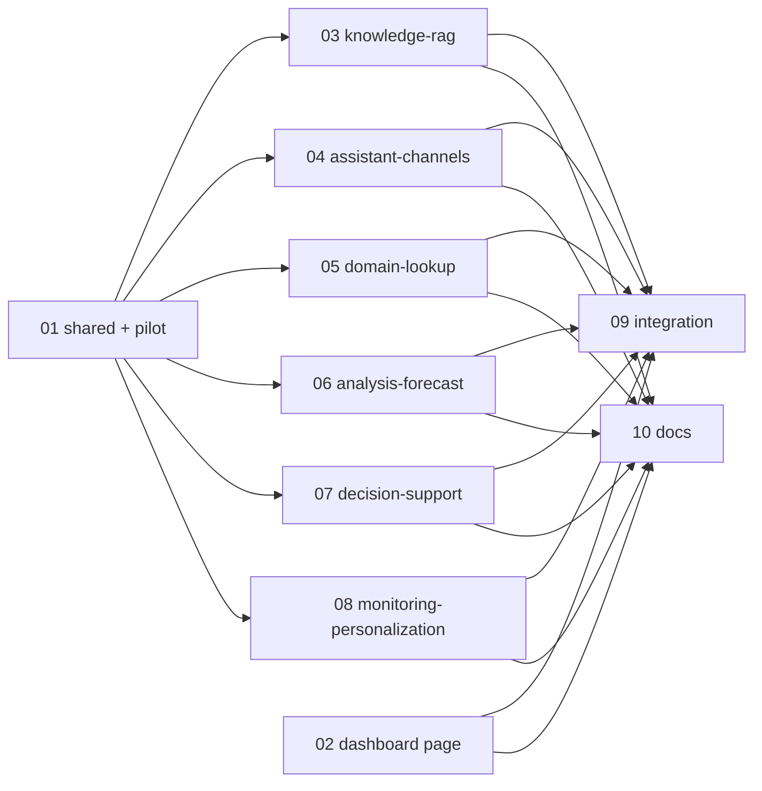

# BKT Modules page + DIA AI plugins

Source contract: [`../reports/brainstorm-261112-0727-bkt-modules-page-and-diaai-plugins.md`](../reports/brainstorm-261112-0727-bkt-modules-page-and-diaai-plugins.md)
DIA AI spec: `D:\Sources\fish\outsources\ironman-all\ironman-diaai-system\docs\DIAAI_SPECS` (`02-Function-Catalog/function-catalog.md`, `03-Function-Specs/fNNN-*.md`)
Data service: `D:\Sources\fish\outsources\ironman-all\ironman-mcp-api\cncns-mcp-chatbot-esquery` — `POST /api/v1/query {"question": str}` → `{answer, question, type, sources[]}`, `GET /api/v1/query/test` health (the FastAPI service mounts routers under `API_V1_PREFIX="/api/v1"`). The service has no auth of its own; an optional bearer key is sent only when configured (reverse proxy).

## Outcome

- A **BKT Modules** page in the Hermes web dashboard lists every plugin named `bkt-*`, grouped by category, with a text filter, a category filter and an enabled/disabled status filter. Each module and each category has a switch. Switching calls the existing enable/disable API. A banner says changes apply to new sessions.
- 20 `bkt-dia-*` plugins (one per HERMES-tagged DIA AI function) register read-only tools and a skill. All of them use one shared client for the ES query service.
- An end-user guide in `docs/` explains the page, every module and the setup.

## Locked decisions

| # | Decision |
|---|---|
| 1 | The page lives in the web dashboard (`web/`), next to Plugins. There is no native desktop tab, because the desktop app embeds the dashboard. |
| 2 | Show/hide means enable/disable through `POST /api/dashboard/agent-plugins/{name}/enable|disable` (`plugins.enabled` / `plugins.disabled`). It takes effect in the next session. |
| 3 | 20 plugins are in scope: F002, F005–F007, F010–F012 and F015–F027. |
| 4 | The backend is the ES query service. Settings live under `plugins.entries.bkt-dia-common.settings.*` in `config.yaml`. The optional key goes in `.env` as `BKT_DIA_QUERY_API_KEY`, resolved per-profile via `hermes_cli.env_loader.resolve_home_dotenv(get_hermes_home())` (never bare unbound `os.environ`). | Implementation note (phase 01): the key is read via the published `hermes_cli.config.get_env_value_prefer_dotenv` (profile `.env` first, then profile-scoped secret), because `env_loader` is not on the plugin API. |
| 5 | The category is stored as a manifest tag `category:<slug>`. The manifest parser already accepts `tags`. |

## Architecture (stable contracts every phase relies on)

- **Shared module** `plugins/bkt_dia_common/` (manifest name `bkt-dia-common`, tag `category:shared`). It is an in-tree plugin *module*, so other modules may import `plugins.bkt_dia_common.*`: `scripts/boundary_lint.py` does not count module→module imports as crossings. The settings, the client and the `register_query_tools()` helper live here. Configuration is read **at call time** through `hermes_cli.config` (published API), never at import time, so profile scope holds. The query client validates endpoints against cloud-metadata/SSRF via `tools.url_safety`, uses a default 15s timeout, and checks that `bkt-dia-common` is active before querying.
- **Module spec contract** (frozen in phase 01). Each plugin's `plugin.yaml` explicitly declares `provides_tools: [...]` (required by `hermes plugins validate` and toolset unregistration). Each plugin's `__init__.py` declares `MODULE = {"function_code": "F015", "toolset": "bkt-dia-enterprise-profile", "tools": [...]}` and calls `register_query_tools(ctx, MODULE)`. It also calls `ctx.register_skill()`. Each plugin is capped at **1-2 tools** (unified query/search where possible) to avoid prompt surface token bloat. Templating uses safe parameter interpolation (no `KeyError` on optional fields or unescaped braces).
- **Tool result shape**: `{"ok": true, "answer", "type", "sources", "function_code"}`, or `{"ok": false, "error", "hint"}`. The tools fail closed when the endpoint is unset or unreachable, when `bkt-dia-common` is disabled, or when the endpoint returns non-2xx status. They never return fabricated data.
- **Read-only**: no write or update tools (spec: write tools need policy, confirmation and audit, which are not available).
- **Prompt surface**: bundled plugins are opt-in (`plugins.enabled` allow-list), so the stock `tools[]` snapshot is unchanged. Phase 09 verifies this.
- **Hub row** gains `tags: string[]`, a generic field read from the manifest. The page normalizes and derives categories from `category:<slug>` tags. In `web/src/i18n/types.ts`, `bktModulesPage?: ...` is optional with English strings in `en.ts` and bilingual fallbacks in UI components. Category toggle handles indeterminate state and sequences requests to prevent race conditions.

## Plugin and category table (file ownership source of truth)

| Category slug | Phase | Function → plugin dir (`plugins/<dir>/`) |
|---|---|---|
| shared | 01 | — → `bkt_dia_common` (manifest `bkt-dia-common`) |
| domain-lookup | 01 (pilot) | F015 → `bkt-dia-enterprise-profile` |
| knowledge-rag | 03 | F002 → `bkt-dia-document-intake`, F005 → `bkt-dia-knowledge-governance`, F006 → `bkt-dia-rag-retrieval`, F007 → `bkt-dia-knowledge-insights` |
| assistant-channels | 04 | F010 → `bkt-dia-admin-assistant`, F011 → `bkt-dia-channel-assistant`, F012 → `bkt-dia-conversation-assistant` |
| domain-lookup | 05 | F016 → `bkt-dia-finance-tax`, F017 → `bkt-dia-import-export`, F018 → `bkt-dia-digital-products`, F019 → `bkt-dia-workforce`, F020 → `bkt-dia-tech-zones-projects` |
| analysis-forecast | 06 | F021 → `bkt-dia-finance-forecast`, F022 → `bkt-dia-sector-forecast` |
| decision-support | 07 | F023 → `bkt-dia-policy-advisor`, F024 → `bkt-dia-strategy-advisor`, F025 → `bkt-dia-partner-matchmaking` |
| monitoring-personalization | 08 | F026 → `bkt-dia-risk-monitor`, F027 → `bkt-dia-personalization-insights` |

Total: 20 function plugins and 1 shared module.

## Phases and waves

| Wave | Phase | Owner files (disjoint) | Depends on | Status |
|---|---|---|---|---|
| A | [01 Shared foundation + pilot](phase-01-shared-foundation-and-pilot-plugin.md) | `plugins/bkt_dia_common/**`, `plugins/bkt-dia-enterprise-profile/**`, `tests/plugins/bkt_dia/test_common*.py`, `tests/plugins/bkt_dia/test_enterprise_profile.py`, `tests/plugins/bkt_dia/conftest.py` | — | done |
| A | [02 BKT Modules dashboard page](phase-02-bkt-modules-dashboard-page.md) | `hermes_cli/web_server_dashboard.py` (hub row `tags`), `web/src/pages/BktModulesPage.tsx`, `web/src/pages/bkt-modules/**`, `web/src/lib/api.ts` (type only), `web/src/App.tsx` (route + nav), `web/src/i18n/*.ts`, `tests/hermes_cli/test_plugins_hub_tags.py` | tag contract only | done |
| B | [03 Knowledge & RAG](phase-03-knowledge-rag-plugins.md) | 4 plugin dirs + `tests/plugins/bkt_dia/test_knowledge_rag.py` | 01 | done |
| B | [04 Assistant & channels](phase-04-assistant-channels-plugins.md) | 3 plugin dirs + `tests/plugins/bkt_dia/test_assistant_channels.py` | 01 | done |
| B | [05 Domain lookup](phase-05-domain-lookup-plugins.md) | 5 plugin dirs + `tests/plugins/bkt_dia/test_domain_lookup.py` | 01 | done |
| B | [06 Analysis & forecast](phase-06-analysis-forecast-plugins.md) | 2 plugin dirs + `tests/plugins/bkt_dia/test_analysis_forecast.py` | 01 | done |
| B | [07 Decision support](phase-07-decision-support-plugins.md) | 3 plugin dirs + `tests/plugins/bkt_dia/test_decision_support.py` | 01 | done |
| B | [08 Monitoring & personalization](phase-08-monitoring-personalization-plugins.md) | 2 plugin dirs + `tests/plugins/bkt_dia/test_monitoring_personalization.py` | 01 | done |
| C | [09 Integration & verification](phase-09-integration-verification.md) | `tests/plugins/bkt_dia/test_all_modules_contract.py`, `scripts/boundary_lint_baseline.json` (only if needed) | 02–08 | done |
| C | [10 End-user & config docs](phase-10-end-user-documentation.md) | `docs/bkt-dia-modules-user-guide.md`, `docs/bkt-dia-modules-admin-setup.md`, `website/docs/user-guide/features/bkt-modules.md` (only if the docs-drift test requires it) | 02–08 | done |

Run waves with `/ak-cook --parallel`. Wave A runs 2 agents. Wave B runs 6 agents. Wave C runs 2 agents.

## Global acceptance criteria

1. The page at `/bkt-modules` lists exactly the installed `bkt-*` plugins (non-bkt plugins are absent), grouped by category. The text, category and status filters work together. A toggle persists and survives a reload. A category toggle switches every module in that category.
2. Each of the 20 plugins passes `hermes plugins validate plugins/<dir>`. Each one has a `category:*` tag, at least one tool and a skill. Each one has a behaviour test against a real local stub HTTP server, plus a fail-closed test for an unset endpoint and for HTTP 5xx.
3. In a temp `HERMES_HOME`, an enabled plugin's tools appear in a new session's tool list and a disabled plugin's tools do not.
4. `python scripts/check`, the touched suites through `scripts/run_tests.sh`, `tests/ci/test_prompt_surface.py`, `tests/scripts/test_boundary_lint.py`, `tests/ci/test_docs_drift.py`, and web `npm run typecheck && npm run lint && npm test` all pass.
5. The end-user guide (Vietnamese primary) covers the page, all 20 modules by category, honest UC coverage (what each module does and does not do yet) and ES endpoint setup.

## Risks

- **The NL `/query` may not cover every domain.** Each phase records a per-module coverage table (UCs that are covered, partial or not covered), and phase 10 publishes it. The tools must not pretend.
- **Forecasting (F021/F022), matchmaking (F025) and governance (F005)** need computation or write paths that do not exist. Those modules ship retrieval plus a skill that guides LLM-side analysis, labelled "analysis, not a statistical forecast".
- **Parallel agents editing a shared file.** Only phase 01 touches `plugins/bkt_dia_common`. If a wave-B phase needs a change there, it reports `NEEDS_CONTEXT` to the controller instead of editing.

## Unresolved questions

- None. (Resolved in Validation Session 1: Single shared service identity for Phase 1 MVP; Vietnamese primary documentation with concise English executive summary and English website feature guide.)

## Validation Log

### Session 1 — 2026-11-12
**Trigger:** Plan validation gate (`/agy-plan validate`)
**Questions asked:** 4

#### Verification Results
- **Tier:** Full (10 phases)
- **Claims checked:** 15
- **Verified:** 15 | **Failed:** 0 | **Unverified:** 0
- **Failures:** None

#### Questions & Answers

1. **[Assumptions & Security]** How should DIA AI ES query service user permissions and data access control (spec §7.2) be handled?
   - Options: Single shared service identity for Phase 1 (MVP); defer per-user ACLs until backend ES service adds auth context | Pass active Hermes profile name as a request header to facilitate future backend routing | Require per-user API tokens in profile configuration before allowing queries
   - **Answer:** Single shared service identity for Phase 1 (MVP); defer per-user ACLs until backend ES service adds auth context
   - **Custom input:** None
   - **Rationale:** The backend ES query service (`cncns-mcp-chatbot-esquery`) does not support user-scoped ACLs or token introspection in `/api/v1/query`. Using a single shared service identity keeps the query client lean, profile-safe, and avoids speculative authentication wrappers.

2. **[Scope & Documentation]** What language strategy should be adopted for the end-user and administrator documentation?
   - Options: Vietnamese primary with concise English executive summary in docs/ and English guide in website/docs | Full bilingual documentation with complete parallel guides in Vietnamese and English | Vietnamese-only documentation across all files
   - **Answer:** Vietnamese primary with concise English executive summary in docs/ and English guide in website/docs
   - **Custom input:** None
   - **Rationale:** Business stakeholders and end users of DIA AI operate primarily in Vietnamese, while developer guides and CI/CD docs drift checks require English content.

3. **[Architecture & Performance]** How should the 20 DIA AI plugins be activated by default to manage prompt surface tokens?
   - Options: Strictly opt-in (all 20 plugins disabled by default; users enable needed modules via BKT Modules page to conserve tokens) | Enable bkt-dia-common and pilot bkt-dia-enterprise-profile by default, keeping remaining 19 opt-in | Provide predefined category preset bundles (e.g. Core Enterprise, RAG & Knowledge) on the BKT Modules page
   - **Answer:** Strictly opt-in (all 20 plugins disabled by default; users enable needed modules via BKT Modules page to conserve tokens)
   - **Custom input:** None
   - **Rationale:** Strict opt-in protects the stock `tools[]` prompt surface snapshot from baseline regression and allows users to selectively load tools on demand without bloating conversation context windows.

4. **[Risks & Reliability]** When the DIA ES query service is unreachable, times out (15s SLA), or returns 5xx, how should the tools behave?
   - Options: Fail closed immediately with structured error/hint; skill guides agent to report outage transparently without guessing | Retry once with a 2-second backoff before returning structured error | Return empty results with a degraded status flag allowing agent to fall back to general knowledge
   - **Answer:** Fail closed immediately with structured error/hint; skill guides agent to report outage transparently without guessing
   - **Custom input:** None
   - **Rationale:** Immediate fail-closed behavior ensures prompt execution doesn't block agent turn loops, prevents hallucinated/speculative responses, and gives the user actionable remediation hints.

#### Confirmed Decisions
- Service Identity: Single shared service identity for Phase 1 (MVP) — avoids auth complexity until ES service supports auth context.
- Documentation Strategy: Vietnamese primary with concise English executive summary in `docs/` and English feature guide in `website/docs` — meets local user needs while maintaining developer/CI standards.
- Plugin Activation: Strictly opt-in (all 20 plugins disabled by default) — protects prompt cache, zero stock surface leakage, minimal token consumption.
- Error Handling: Fail closed immediately with structured `{"ok": false, "error", "hint"}` — ensures honest agent reporting without latency penalty or fabricated data.

#### Action Items
- [x] Document confirmed decisions in `plan.md` and resolve open questions.
- [x] Propagate confirmation markers and language/opt-in specifications into Phase 01, Phase 02, and Phase 10.
- [x] Verify whole-plan consistency across all 10 phase documents.

#### Impact on Phases
- `plan.md`: Resolved all items under `## Unresolved questions`.
- Phase 01 (`phase-01-shared-foundation-and-pilot-plugin.md`): Confirmed fail-closed policy, 15s timeout SLA, and single shared identity.
- Phase 02 (`phase-02-bkt-modules-dashboard-page.md`): Confirmed all DIA plugins are opt-in by default, surfaced via toggle switches.
- Phase 10 (`phase-10-end-user-documentation.md`): Confirmed doc deliverables structure (Vietnamese primary guide + English summary + English website guide).

### Whole-Plan Consistency Sweep
- Files reread: `plan.md`, `phase-01-shared-foundation-and-pilot-plugin.md`, `phase-02-bkt-modules-dashboard-page.md`, `phase-03-knowledge-rag-plugins.md`, `phase-04-assistant-channels-plugins.md`, `phase-05-domain-lookup-plugins.md`, `phase-06-analysis-forecast-plugins.md`, `phase-07-decision-support-plugins.md`, `phase-08-monitoring-personalization-plugins.md`, `phase-09-integration-verification.md`, `phase-10-end-user-documentation.md`
- Decision deltas checked: 4
- Reconciled stale references: 2 (unresolved questions converted to locked decisions)
- Unresolved contradictions: 0

## Red Team Review

### Session — 2026-11-12
**Findings:** 13 (13 accepted, 0 rejected)
**Severity breakdown:** 3 Critical, 5 High, 5 Medium

| # | Finding | Severity | Disposition | Applied To |
|---|---------|----------|-------------|------------|
| 1 | Incorrect ES service route (`/query` vs `/api/v1/query`) | Critical | Accept | `plan.md`, Phase 01 |
| 2 | Missing `provides_tools` in `plugin.yaml` breaks admission validation | Critical | Accept | Phase 01, Phases 03–08 |
| 3 | Non-existent `vi.ts` locale in dashboard web i18n & strict typecheck failure | Critical | Accept | `plan.md`, Phase 02 |
| 4 | Profile leak via unbound `os.environ` for `BKT_DIA_QUERY_API_KEY` | High | Accept | `plan.md`, Phase 01 |
| 5 | Missing URL safety & SSRF guard on configured endpoint | High | Accept | `plan.md`, Phase 01 |
| 6 | Unhandled format string crashes on optional arguments & user braces | High | Accept | `plan.md`, Phase 01 |
| 7 | Sequential category toggle lock contention & indeterminate partial failure | High | Accept | `plan.md`, Phase 02 |
| 8 | Excessive 60s default timeout blocks synchronous agent turn execution | High | Accept | `plan.md`, Phase 01 |
| 9 | Disconnect between "bkt-dia-common must stay on" rule and unenforced code | Medium | Accept | `plan.md`, Phase 01 |
| 10 | Optimistic UI rollback overwrite from out-of-order hub refetches | Medium | Accept | `plan.md`, Phase 02 |
| 11 | Prompt surface token bloat from 40–80 tools across 20 plugins | Medium | Accept | `plan.md`, Phases 03–08, Phase 10 |
| 12 | Inaccurate citation of `tests/ci/test_docs_drift.py` for web routes | Medium | Accept | Phase 10 |
| 13 | Category tag normalization in manifest parsing and web grouping | Medium | Accept | `plan.md`, Phase 02 |

### Whole-Plan Consistency Sweep
- Files reread: `plan.md`, `phase-01-shared-foundation-and-pilot-plugin.md`, `phase-02-bkt-modules-dashboard-page.md`, `phase-03-knowledge-rag-plugins.md`, `phase-04-assistant-channels-plugins.md`, `phase-05-domain-lookup-plugins.md`, `phase-06-analysis-forecast-plugins.md`, `phase-07-decision-support-plugins.md`, `phase-08-monitoring-personalization-plugins.md`, `phase-09-integration-verification.md`, `phase-10-end-user-documentation.md`
- Decision deltas checked: 13
- Reconciled stale references: 13
- Unresolved contradictions: 0
