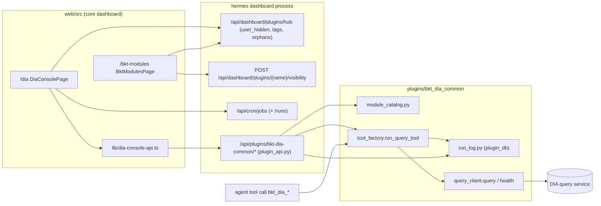

# DIA AI Console + unified UI visibility

Source contract: [`../reports/brainstorm-261117-1240-dia-console-and-unified-ui-visibility.md`](../reports/brainstorm-261117-1240-dia-console-and-unified-ui-visibility.md).
It builds on [`../261112-1101-bkt-modules-page-and-diaai-plugins/plan.md`](../261112-1101-bkt-modules-page-and-diaai-plugins/plan.md), which is done.

## Outcome

1. A new core web page at `/dia` (**DIA AI Console**) has five parts:
   - **Status overview:** whether the endpoint is configured, a health card (status, document count, latency), and a per-module grid.
   - **Category views:** each module is a panel. Each tool gets a schema-generated form. **Run** shows a step timeline, then the answer and its sources.
   - **Recent runs:** what the agent and the console ran, for the active profile only.
   - **Monitoring:** cron jobs that use bkt-dia skills, with their last status and output.
2. The **BKT Modules** page becomes the single show/hide place. Every row gets a **Show UI** switch (`dashboard.hidden_plugins`) beside the existing **Enabled** switch. The page also lists the 8 dashboard-only bkt tabs and a "DIA Console" row.

## Decisions (user, 2026-11-17)

- **Data source:** only what exists. That is the DIA query service (`POST /api/v1/query`, `GET /api/v1/query/test`) plus Hermes-side state. No new DIA endpoints.
- **The console is a core page** in `web/src`. It is not an additive `bkt/packages` plugin.
- **The show/hide view is the existing `/bkt-modules` page, extended.**

## Architecture

- **No core→plugin import.** The page reaches the plugin only over HTTP, through `/api/plugins/bkt-dia-common/*`. The plugin's dashboard manifest declares `tab.hidden: true` and `api: plugin_api.py`.
- **One run path.** The agent tool handler and the console run route both call `run_query_tool`. Validation, template rendering, URL safety, fail-closed checks and the run log therefore behave the same for both.
- **Visibility reuses `dashboard.hidden_plugins`. No new config key.**
  - A module's Show UI hides its panel. The console reads `user_hidden` from the hub.
  - The `bkt-dia-common` Show UI hides the `/dia` nav entry. `GET /api/dashboard/plugins` already drops hidden plugins, so the nav checks whether that manifest is present.

## Plugin API contract (frozen; phases 1 and 2 build against it)

Every route calls `_require_token` and honours `?profile=` (bound by the host's `_plugin_route_secret_scope`). The API key and the endpoint value are never returned.

| Route | Response |
|---|---|
| `GET /api/plugins/bkt-dia-common/modules` | `{"common_enabled": bool, "endpoint_configured": bool, "categories": [{"slug","label_vi","label_en"}], "modules": [{"name","function_code","category","title","description","emoji","enabled", "tools":[{"name","description","parameters"}]}]}` |
| `GET /api/plugins/bkt-dia-common/health` | `{"ok": true, "status", "total_documents", "latency_ms"}` or `{"ok": false, "error", "hint", "stage"}` |
| `POST /api/plugins/bkt-dia-common/run` body `{"module","tool","arguments":{}}` | `{"ok", "steps":[{"key","status","ms"}], "question"?, "answer"?, "type"?, "sources"?, "error"?, "hint"?, "stage"?, "function_code"}`. HTTP 404 for an unknown module or tool. HTTP 200 with `ok:false, stage:"disabled"` for a disabled module. |
| `GET /api/plugins/bkt-dia-common/runs?limit=50` | `{"runs":[{"id","at","module","tool","source":"agent"\|"console","ok","stage","error","duration_ms","question_preview"}]}` |

- `stage` values: `validate`, `disabled`, `config`, `url_safety`, `network`, `http`, `response`.
- Step keys, in order: `validate`, `build_question`, `query`, `result`. A step's status is `ok`, `error` or `skipped`.

## Phases

| # | Phase | Owner files | Depends on | Status |
|---|---|---|---|---|
| 01 | [Console backend in bkt-dia-common](phase-01-console-backend-plugin-api.md) | `plugins/bkt_dia_common/**`, `tests/plugins/bkt_dia/**`, `hermes_cli/web_server_dashboard.py`, `tests/hermes_cli/test_plugins_hub_tags.py` | — | pending |
| 02 | [Web shared wiring: client, route, nav, i18n](phase-02-web-shared-wiring.md) | `web/src/lib/dia-console-api.ts`, `web/src/App.tsx`, `web/src/i18n/{types,en}.ts` | contract above | pending |
| 03 | [DIA Console page](phase-03-dia-console-page.md) | `web/src/pages/DiaConsolePage*.tsx`, `web/src/pages/dia-console/**` | 02 | pending |
| 04 | [BKT Modules: Show UI toggles](phase-04-bkt-modules-show-ui-toggles.md) | `web/src/pages/BktModulesPage*.tsx`, `web/src/pages/bkt-modules/**` | 02 | pending |
| 05 | [Docs and full verification](phase-05-docs-and-verification.md) | `docs/bkt-dia-modules-*.md`, `website/docs/user-guide/features/bkt-modules.md`, `bkt/UPSTREAM-SEAMS.md` | 01–04 | pending |

**Running phases in parallel.** Phases 01 and 02 run together; they share only the frozen contract. Phases 03 and 04 run together after 02, with disjoint directories. Phase 02 alone touches the shared web files (`App.tsx`, i18n), so 03 and 04 never edit them.

## Acceptance criteria

1. `/dia` lists all 20 modules grouped by the 7 categories.
   - A disabled module shows a "Disabled" badge and a link to `/bkt-modules`, without a form.
   - A module whose UI is hidden is not rendered.
2. The health card shows status and document count against the stub. It shows the matching error and hint when the endpoint is unset, invalid, blocked by URL safety, unreachable, returning non-2xx, or returning the wrong shape.
3. Each tool form is generated from its JSON schema (string, integer, number, boolean, enum) and blocks submit when a required field is empty.
   - Run shows the four-step timeline, the answer as markdown, and the sources.
   - The server refuses a run for a disabled module, and a test proves it.
4. Recent runs list agent and console runs for the active profile only, proven with two temp homes. The log is capped at 500 rows. It never stores answers or secrets.
5. Monitoring lists cron jobs whose `skills` include a `bkt-dia-*` skill, with schedule, last run status and a link to the last output.
6. BKT Modules lists every `bkt-*` agent plugin, the 8 dashboard-only bkt tabs, and the DIA Console row.
   - Show UI persists to `dashboard.hidden_plugins`.
   - After a refresh, a hidden tab leaves the sidebar, a hidden module leaves the console, and a hidden console removes the `/dia` nav entry.
7. A private or loopback DIA endpoint works with `security.allow_private_urls: false`. Cloud-metadata and ambiguous-authority endpoints are refused with stage `url_safety`, and no request is sent.
8. Gates:
   - `scripts/run_tests.sh tests/plugins/bkt_dia tests/hermes_cli/test_plugins_hub_tags.py` passes.
   - The web vitest, typecheck and lint are clean.
   - `scripts/boundary_lint.py --check` is unchanged (843/20).
   - `python scripts/check` shows no new findings beyond the existing `apps/desktop/src/i18n/vi.ts` FILE_LINES finding.
   - `web/src/lib/api.ts` (already over the 2000-line cap) does not grow.
   - The prompt surface is unchanged (no new tools).

## Non-goals

- DIA-side pipeline steps, document or index listings, stored forecasts, and monitoring records.
- Writing to DIA, editing module specs from the UI, and forecast charts.
- Zalo, and the business-analyst questions from the previous plan.
- Business process steps from the DIA function specs. The panels show run steps only.
- Rebuilding BKT Modules as an additive plugin.
- `bkt-dia-*` modules installed outside this checkout. The catalog reads bundled sibling directories only.

## Risks

- **Core web edits conflict with upstream.** `App.tsx` and i18n are touched; the user accepted this. Edits stay small and the code lives in new files.
- **A hidden-tab plugin still loads `entry`.** Phase 01 ships a hand-written `dist/index.js` that registers a null component. That avoids a script 404 and an unregistered-plugin warning.
- **Loading `MODULE` from 20 sibling dirs at request time.** The catalog imports each `__init__.py` by file path under a private module name, without calling `register()`, and caches by mtime. An import error marks that module `error` instead of failing the page.
- **Private core import (`hermes_cli.web_server._require_token`).** This follows the existing bkt-prompts and bkt-files precedent. It is recorded in `bkt/UPSTREAM-SEAMS.md`.

## Validation Log

### Session 1 (2026-11-17)

1. **Spec process steps in panels:** No. Panels show run steps only. Recorded in Non-goals.
2. **Run log question preview:** store 200 characters. Answers are never stored, the log is capped at 500 rows, and it lives in the profile's local `plugin-data`. Phases 01 and 05.
3. **`bkt-brand` and `bkt-author` Show UI:** allowed, labelled "Header logo" and "Credit line". Phase 04.
4. **Private endpoint (M1):** fixed in this plan.
   - For the configured DIA endpoint only, `is_safe_url` is replaced by the floor check `is_always_blocked_url`.
   - Private and internal hosts work without the global `security.allow_private_urls`. Metadata and ambiguous authorities stay blocked, and redirects are still not followed.
   - Changes: phase 01 (code and tests), phase 05 (admin docs).

### Verification Results

- Claims checked: 14. Verified: 14. Failed: 0. Unverified: 0. Tier: Full (5 phases).
- Checked:
  - Plugin API mount gate: `web_server_dashboard.py:880`.
  - Per-request profile scope: `_plugin_route_secret_scope`.
  - The visibility endpoint accepts any valid name: `dashboard_ui.py:363`.
  - Hub `user_hidden` and `orphan_dashboard_plugins`.
  - `plugin_storage.plugin_db` is published.
  - `window.__HERMES_PLUGINS__.register(name, Component)`.
  - `Markdown` component export.
  - Cron job `skills` field.
  - `fetchJSON` auto-scopes `/api/plugins/` and `/api/dashboard/plugins` (`api-request-scope.ts`).
  - `getCronJobs` takes an explicit profile.
  - `api.ts` is at 2670 lines (over the cap).
  - `TestClient` pattern in `tests/plugins/bkt_prompts/test_crud.py`.
  - `is_always_blocked_url` exists: `tools/url_safety.py:316`.
  - The stub server serves `/api/v1/query/test`.
- Corrections applied:
  - `api.ts` has no cron-runs call, so `getCronJobRuns` moves into `dia-console-api.ts`.
  - Plugin calls rely on `fetchJSON` profile auto-scoping instead of manual `?profile=`.

### Whole-Plan Consistency Sweep

- M1 has moved from Non-goals and Unresolved into phases 01 and 05.
- The spec-steps question is closed as a non-goal.
- No contradictions remain between `plan.md`, the phase files, and the frozen API contract.

## Red Team Review

### Session — 2026-11-17
**Findings:** 8 (8 accepted, 0 rejected)
**Severity breakdown:** 1 Critical, 3 High, 3 Medium, 1 Low

| # | Finding | Severity | Disposition | Applied To |
|---|---------|----------|-------------|------------|
| 1 | `orphan_dashboard_plugins` lacks `user_hidden` in backend hub response | Critical | Accept | Phase 01, Phase 04 |
| 2 | `is_always_blocked_url` bypasses userinfo check on floor mode; test will fail | High | Accept | Phase 01 |
| 3 | Boolean inversion risk on `is_always_blocked_url` (returns True when blocked) | High | Accept | Phase 01 |
| 4 | Unclosed SQLite connections in `run_log.py` cause Windows file lock / handle leaks | High | Accept | Phase 01 |
| 5 | Synchronous SQLite prune on every insert causes write lock contention | Medium | Accept | Phase 01 |
| 6 | Inaccurate assertion that `is_always_blocked_url` does not resolve DNS | Medium | Accept | Phase 01 |
| 7 | Plaintext question previews in `runs.db` lack token/credential redaction | Medium | Accept | Phase 01 |
| 8 | Missing empty state on `/dia` when all modules or categories are hidden | Low | Accept | Phase 03 |

### Whole-Plan Consistency Sweep
- Files reread: `plan.md`, `phase-01-console-backend-plugin-api.md`, `phase-02-web-shared-wiring.md`, `phase-03-dia-console-page.md`, `phase-04-bkt-modules-show-ui-toggles.md`, `phase-05-docs-and-verification.md`
- Decision deltas checked: 8
  - Attached `"user_hidden"` to `orphan_dashboard_plugins` in `hermes_cli/web_server_dashboard.py` and assigned ownership to Phase 01.
  - Added explicit userinfo rejection and documented boolean polarity of `is_always_blocked_url()` in `query_client.py`.
  - Reconciled DNS resolution behavior of `is_always_blocked_url()` with async FastAPI handler threading requirements.
  - Added `contextlib.closing` connection safety, token redaction, and opportunistic pruning to `run_log.py`.
  - Added empty state handling to `DiaConsolePage.tsx` when `visibleModules.length === 0`.
- Reconciled stale references: 4
- Unresolved contradictions: 0

## Unresolved questions

None.
